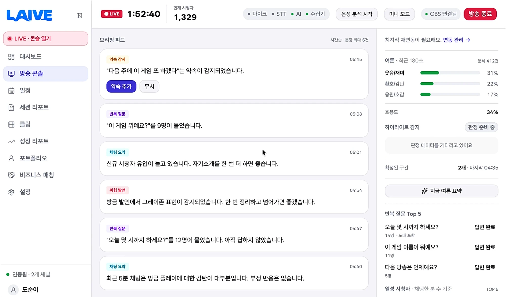
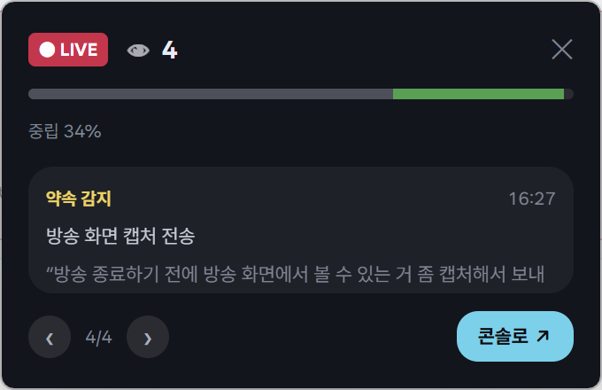
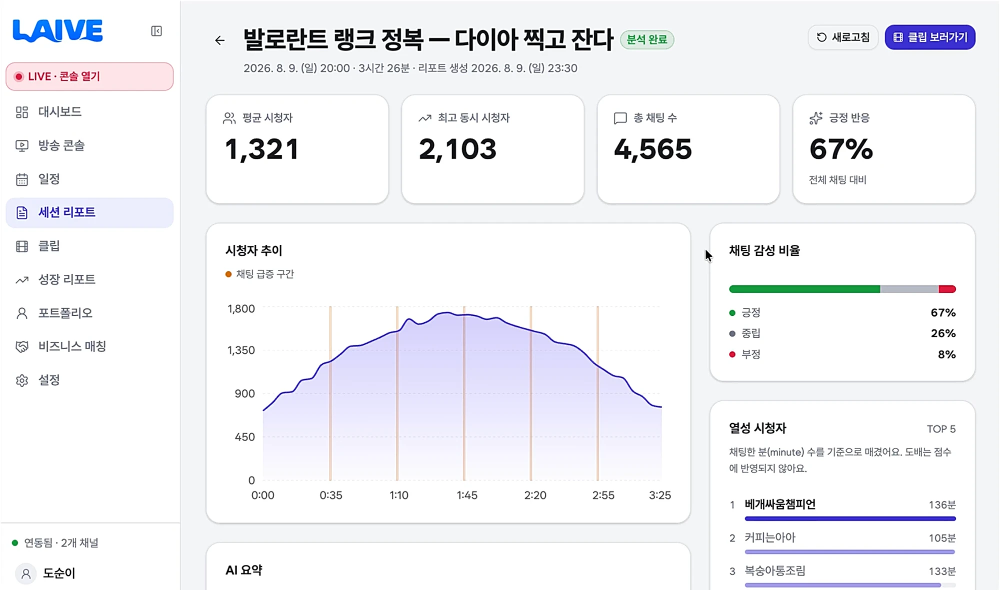
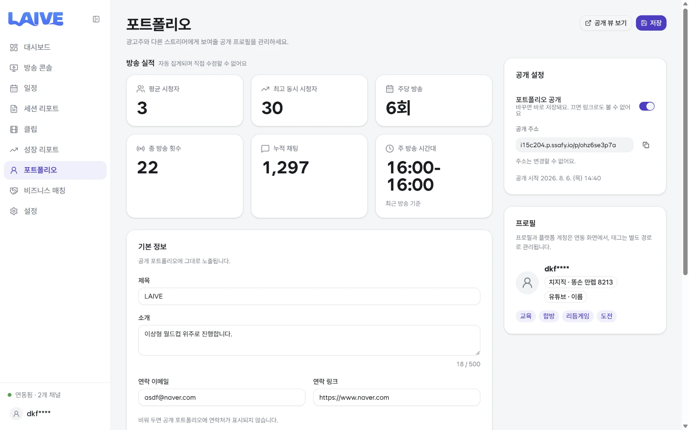
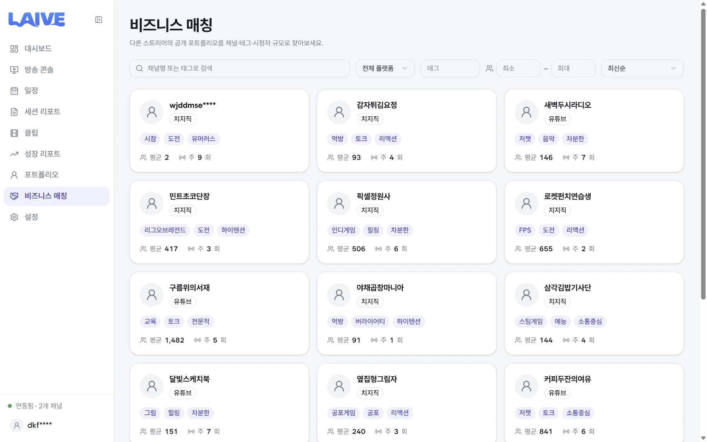
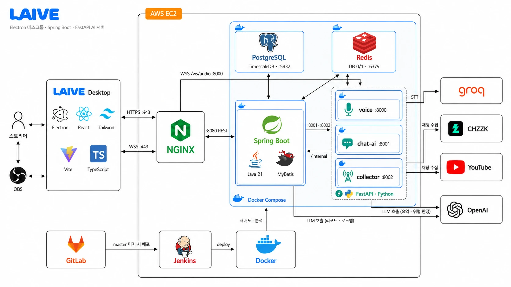

<div align="center">
  

  <p><b>1인 스트리머를 돕는 똑똑한 비서 : AI Manager</b><br>
  <i>혼자여도, 혼자가 아닌 방송</i></p>

  <p>
    
    
    
  </p>

  <p>
    
    
    
    
    
    
  </p>
</div>

---

## 목차

1. [서비스 소개](#1-서비스-소개)
2. [핵심 기능](#2-핵심-기능)
3. [시스템 아키텍처](#3-시스템-아키텍처)
4. [기술 스택](#4-기술-스택)
5. [기술적 특장점](#5-기술적-특장점)
6. [기대 효과](#6-기대-효과)
7. [산출물](#7-산출물)
8. [시작하기](#8-시작하기)
9. [프로젝트 구조](#9-프로젝트-구조)
10. [문서 인덱스](#10-문서-인덱스)
11. [팀 소개](#11-팀-소개)

---

## 1. 서비스 소개

**LAIVE는 1인 스트리머의 방송 전 과정을 하나의 데스크톱 앱에서 보조하는 AI 방송 콘솔입니다.**
방송 중에는 놓치면 안 되는 순간을 실시간으로 감지하고, 방송이 끝나면 그 기록을 리포트·클립·성장 목표·포트폴리오로 전환합니다.

1인 스트리머는 기획부터 방송 진행, 채팅 관리, 다시보기 확인까지 모두 혼자 수행합니다.
그 과정에서 발생한 정보는 대부분 **놓침**으로 끝납니다 — 반복된 질문은 채팅창을 거슬러 올라가야 알 수 있고,
즉흥적으로 한 약속은 방송이 끝나면 휘발되며, 위험한 발언은 클립이 퍼진 뒤에야 알게 됩니다.
LAIVE는 이 놓침을 **실시간 감지 → 자동 기록 → 사후 자산화** 세 단계로 처리합니다.

<table>
<tr>
<th width="150">단계</th>
<th width="330">역할</th>
<th>대표 기능</th>
</tr>
<tr>
<td><b>① 실시간 감지</b></td>
<td>방송에 집중하는 동안 놓치면 안 되는 순간을 대신 감시</td>
<td>위험 발언 감지 · 약속 감지 · 반복 질문 클러스터링</td>
</tr>
<tr>
<td><b>② 자동 기록</b></td>
<td>감지한 순간을 타임스탬프·원문과 함께 유실 없이 보관</td>
<td>세션 타임라인 · 하이라이트 구간 확정</td>
</tr>
<tr>
<td><b>③ 사후 자산화</b></td>
<td>쌓인 기록을 리포트·클립·목표·포트폴리오로 전환</td>
<td>세션/성장 리포트 · 자동 클립 · 비즈니스 매칭</td>
</tr>
</table>

| 사용자 | 접근 방식 | 사용 화면 |
|---|---|---|
| **스트리머** | Electron 데스크톱 앱 (로그인) | 방송 콘솔 · 세션/성장 리포트 · 클립 · 포트폴리오 관리 |
| **광고주 · 시청자** | 웹 브라우저 (로그인 불필요) | 공개 포트폴리오 · 스트리머 디렉터리 |

---

## 2. 핵심 기능

### 방송 콘솔 — 방송 중 실시간 감지



좌측 사이드바로 화면을 이동하고, 중앙 **브리핑 피드**에 감지 이벤트가 시간순으로 도착하며,
우측 **지표 패널**에 누적 지표가 갱신됩니다. 상단 바에는 LIVE 타이머, 현재 시청자 수,
상태칩 4종(마이크 · STT · AI · 수집기), OBS 연결 상태가 상시 표시됩니다.

**브리핑 피드** — 감지 결과가 카드로 도착하며, 카드별로 별도의 파이프라인을 가집니다.

| 카드 | 내용 |
|---|---|
| **약속**&nbsp;**감지** | 발화에서 약속 표현·대상·기한을 추출해 일정으로 등록. `약속 추가` / `무시` 선택 |
| **반복**&nbsp;**질문** | 같은 취지의 채팅을 의미 기준으로 병합하고, 도배를 제외해 실제 문의 인원을 집계 |
| **위험**&nbsp;**발언** | 사전 매칭과 LLM 문맥 판정으로 위험도를 분류해 알림 |
| **채팅**&nbsp;**요약** | 최근 윈도우의 채팅을 압축·샘플링해 LLM으로 요약 |

**지표 패널** — "지금 방송이 어떤 상태인가"를 수치로 유지합니다.

| 지표 | 설명 |
|---|---|
| **여론** | 8감정 분류 결과를 최근 180초 슬라이딩 윈도우로 집계 |
| **호응도** | 평시 대비 반응 온도. 100%를 넘으면 평소보다 뜨거운 상태 |
| **하이라이트 감지** | 채팅량 z-score가 임계를 넘으면 구간 확정. 확정 구간이 클립 원본이 됨 |
| **반복 질문 Top 5** | 질문 그룹 · 문의 인원 · `답변 완료` 처리 |
| **열성 시청자** | 채팅한 분(minute) 수 기준 랭킹 — 도배로는 순위가 오르지 않음 |
| **여론 요약** | 수동 생성. 쿨다운으로 호출 빈도를 제한 |

### 미니 모드 — 방송 화면 위 오버레이

<table>
<tr>
<td width="42%" valign="top">

</td>
<td width="58%" valign="top">
콘솔 전체를 띄워둘 수 없는 상황을 위한 <b>축소 오버레이 창</b>입니다. 방송 화면 위에 떠 있으면서
브리핑 피드와 같은 알림(위험 발언 · 반복 질문 · 약속 감지 · 채팅 요약)을 받습니다.
<br><br>
상단에 LIVE 상태 · 현재 시청자 수 · 여론 게이지를 압축해 보여주고, 하단 <code>‹ 4/4 ›</code>로
놓친 알림을 되돌려 볼 수 있습니다. <code>콘솔로 ↗</code>를 누르면 메인 창의 해당 알림 위치로 이동합니다.
<br><br>
위험 발언처럼 <b>즉시 대응이 필요한 알림</b>을 방송을 가리지 않고 전달하는 것이 이 창의 목적입니다.
</td>
</tr>
</table>

### 세션 리포트 — 방송 후 복기



방송이 끝나면 세션 데이터가 자동 이관되어 리포트가 생성됩니다.

| 구성 | 내용 |
|---|---|
| **요약 지표** | 평균 시청자 · 최고 동시 시청자 · 총 채팅 수 · 긍정 반응 비율 |
| **시청자 추이** | 시청자 곡선 위에 **채팅 급증 구간**을 마커로 표시. 이 구간이 자동 클립의 원본 |
| **채팅 감성 비율** | 8감정 분류를 긍정 / 중립 / 부정으로 집계 |
| **열성 시청자 TOP 5** | 채팅한 분(minute) 수 기준. 도배는 점수에 반영되지 않음 |
| **AI 요약 · 개선 제안** | 지표를 근거로 한 진단과 다음 방송을 위한 행동 지침 |

**클립**은 두 가지 트리거로 자동 생성됩니다 — 위험도 분류(증거 확보)와 채팅 급증 z-score(콘텐츠 재활용).
세션 리포트가 누적되면 성장 리포트의 지표 추이와 목표 로드맵으로, 다시 포트폴리오의 방송 실적으로 이어집니다.

### 포트폴리오 — 방송 기록을 비즈니스 자산으로



광고주와 다른 스트리머에게 보여줄 공개 프로필로, **자동 집계 영역과 큐레이션 영역이 분리**되어 있습니다.

<table>
<tr>
<th width="240">영역</th>
<th width="90">수정</th>
<th>내용</th>
</tr>
<tr>
<td><b>방송 실적</b></td>
<td>불가</td>
<td>평균 시청자 · 최고 동시 시청자 · 주당 방송 · 총 방송 횟수 · 누적 채팅 · 주 방송 시간대</td>
</tr>
<tr>
<td><b>기본 정보 · 대표 하이라이트</b></td>
<td>가능</td>
<td>제목 · 소개 · 연락처 · 노출할 클립과 순서</td>
</tr>
</table>

숫자를 손대지 못하게 해 **신뢰성**을, 보여줄 장면은 직접 고르게 해 **표현력**을 확보한 설계입니다.
공개를 켜면 `/p/<slug>` 주소가 발급되어 설치나 로그인 없이 링크만으로 열람할 수 있고,
연동된 플랫폼 계정과 방송 성향 태그가 함께 노출됩니다.

### 비즈니스 매칭 — 스트리머 디렉터리



공개된 포트폴리오를 채널명·태그·플랫폼·시청자 규모로 탐색합니다.
각 카드에 닉네임, 플랫폼, 성향 태그, 평균 시청자와 주당 방송 횟수가 요약되어
광고주는 협업 대상을, 스트리머는 합방 상대를 지표 기준으로 찾을 수 있습니다.
노출되는 수치는 모두 포트폴리오의 자동 집계 영역에서 오므로 임의로 부풀릴 수 없습니다.

---

## 3. 시스템 아키텍처



구조는 크게 세 계층으로 나뉩니다. 스트리머가 사용하는 **Electron 클라이언트**, 도메인 로직 전반을 담당하는 **Spring Boot**,
음성과 채팅을 실시간 처리하는 **FastAPI AI 서버**입니다.

**AI 계층을 FastAPI로 분리한 것이 구조상 가장 중요한 결정입니다.** 위험 발언 감지는 발화 직후 경고가 떠야 의미가 있는데,
WAS의 요청·응답 주기에 묶이면 이 실시간성을 보장할 수 없습니다. WebSocket 스트리밍과 모델 추론을 별도 프로세스로
떼어낸 덕분에 AI 서버가 재시작되어도 Spring의 세션 관리는 영향을 받지 않습니다.

### 배포 구성

**컨테이너 7개 + 호스트 nginx** 구성이며, **443이 유일한 외부 관문**입니다.

| 경로 | 대상 |
|---|---|
| `/api/`, `/clips/` | `spring:8080` — REST API · 클립 서빙 |
| `/ws/audio` | `voice:8000` — 음성 스트리밍 WebSocket |
| `/assets/`, `/p/<slug>`, `/discover` | 정적 SPA — 공개 포트폴리오 · 스트리머 디렉터리 |
| `/download/` | 정적 — Electron 앱 설치 파일 |
| `/` | `landing:8090` — 랜딩 페이지 |

내부 네트워크(`laive_default`)에서 Spring이 `chat-ai:8001` · `collector:8002` · `voice:8000`을 호출하고,
AI 서버들은 `/internal/**` 토큰 인증으로 Spring에 결과를 되돌립니다.

### 실시간 위험 발언 감지 파이프라인

아키텍처 다이어그램에 드러나지 않는 흐름이라 따로 정리합니다.

```
브라우저 마이크 ──WebSocket(PCM)──▶ FastAPI
                                     │
                             VAD (발화 구간만 추출)
                                     │
                           Groq Whisper (전사)
                                     │
                   ┌─────────────────┴─────────────────┐
            Aho-Corasick 사전매칭              LLM 문맥 판정
              (명백한 비속어)                    (회색지대)
                   └─────────────────┬─────────────────┘
                                     │
                   경고 ──▶ 클라이언트 (WebSocket, 즉시)
                   기록 ──▶ Spring (HTTP, 비동기)
```

---

## 4. 기술 스택

### Frontend — Electron 데스크톱 앱 + 공개 웹 SPA

| 구분 | 기술 | 버전 |
|---|---|---|
| 런타임 | Node.js / pnpm | 24.18.1 / 11.18.0 |
| 데스크톱 | Electron | 39.x |
| UI | React / TypeScript / Tailwind CSS | 19 / 5.9 / 4.x |
| 빌드 | electron-vite / electron-builder / Vite | 5.x / 26.x / 7.x |

### Backend — Spring Boot

| 구분 | 기술 | 버전 |
|---|---|---|
| 프레임워크 | Spring Boot (내장 Tomcat) | 4.0.7 |
| 언어 / 빌드 | Java (Temurin) / Gradle Wrapper | 21 / 9.5.1 |
| 영속성 | MyBatis Spring Boot Starter / Flyway | 4.0.1 / 마이그레이션 `V*.sql` |
| AI 연동 | Spring AI (`spring-ai-starter-model-openai`) | 2.0.0 |
| 문서화 | springdoc-openapi (Swagger) | 3.0.2 |
| 인증 | JWT(HS256) + Refresh Cookie, 네이버 OAuth 2.0 | — |

### AI — Python 서버 3종

| 서버 | 포트 | 역할 | 핵심 기술 |
|---|---|---|---|
| **voice** | 8000 | 실시간 위험 발언 감지 | FastAPI · WebSocket · silero-VAD · Groq Whisper · Aho-Corasick · LLM 판정 |
| **chat-ai** | 8001 | 채팅 8감정 분류 · 여론 요약 · 하이라이트 판정 | **KcELECTRA 파인튜닝 모델** · ONNX Runtime (CPU 추론, int8 129MB) |
| **chat-collector** | 8002 | 치지직 채팅·시청자 수 수집 | socket.io · 배치 전송 |

**감정 분류 모델** — 치지직 채팅 데이터로 파인튜닝한 KcELECTRA를 ONNX로 증류·경량화해 **GPU 없이 CPU에서** 돌립니다.

| 항목 | 값 |
|---|---|
| 베이스 모델 | KcELECTRA |
| 파인튜닝 데이터 | 치지직 채팅 **약 3만 건** (자체 수집·라벨링) |
| 라벨 8종 | `웃음/재미` · `환호/감탄` · `응원/호감` · `놀람` · `슬픔/아쉬움` · `분노/불만` · `혼란/질문` · `중립` |
| 정확도 (골드셋 1,000건) | accuracy **0.780** / macro-F1 **0.714** |
| 모델 크기 | fp32 511MB / int8 129MB |

| 구분 | 기술 | 버전 |
|---|---|---|
| 런타임 | Python | 3.12.13 |
| 패키지 관리 | uv (`uv.lock` 고정) | 0.9.30 |
| LLM | SSAFY GMS 프록시 (`gpt-5-mini` 계열) | OpenAI 호환 |
| STT | Groq Whisper (`whisper-large-v3`) | — |

### Infra / DevOps

| 구분 | 기술 | 버전 |
|---|---|---|
| 서버 | AWS EC2 (Ubuntu) — 4 vCPU / 16GB / 309GB | 24.04.3 LTS |
| 컨테이너 | Docker Engine / Docker Compose | 29.7.1 / v5.3.1 |
| 웹서버 | nginx (호스트 직접 설치, 443 단일 관문) | 1.24.0 |
| DB | PostgreSQL + TimescaleDB | 18.4 + 2.28.2 |
| 캐시 | Redis (AOF 활성) | 8.2.7 |
| CI/CD | Jenkins (커스텀 이미지 `lts-jdk21-python`) | 2.568.1 |
| 인증서 | Let's Encrypt 와일드카드 `*.p.ssafy.io` | — |

### 협업

| 구분 | 도구 |
|---|---|
| 형상 관리 | GitLab (SSAFY) |
| 이슈 · 일정 | Jira |
| 문서 | Notion |
| 디자인 | Figma |
| 커뮤니케이션 | Mattermost |

---

## 5. 기술적 특장점

### 채팅 분석 — LLM 호출을 최소화한 파이프라인

실시간 채팅을 전량 LLM에 넘기면 비용이 채팅량에 비례해 증가합니다.
분류는 자체 호스팅 모델이 전량 처리하고 LLM은 요약만 담당하도록 역할을 나눈 뒤,
LLM에 넘기기 전 입력을 세 단계에 걸쳐 줄였습니다.

```
채팅 원문 → 감정 분류 → 도배 압축 → 리액션 필터 → 임계 감정 샘플링 → LLM 요약
```

| 단계 | 처리 | 결과 |
|---|---|---|
| 감정 분류 | 치지직 채팅 약 3만 건으로 파인튜닝한 KcELECTRA를 ONNX로 증류해 CPU에서 전량 분류 | 분류 단계의 LLM 토큰 소비 없음 |
| 도배 압축 | 정규화 후 완전일치 채팅을 카운트로 병합 | 실측 기준 3분 윈도우의 45~74%가 압축 |
| 리액션 필터 | `ㅋㅋㅋ` 같은 순수 챈트는 LLM에 전달하지 않음 | 감정 분포 수치가 같은 정보를 이미 전달 |
| 임계 감정 샘플링 | 비율이 임계를 넘은 감정의 내용 채팅만 최대 300건 | 요약 품질을 유지하며 입력량 절감 |

중간 발표에서 토큰 비용에 대한 지적을 받아 도입한 구조이며, 개발 기간 동안 크레딧 사용량을 30% 이하로 유지했습니다.

한계도 있습니다. `분노/불만` 라벨의 재현율은 0.508로 불만 채팅의 약 절반을 놓칩니다.
표면 표지(`ㅋㅋ`, `ㅠㅠ`, `?`)가 없어 의미를 이해해야 하는 유일한 라벨이기 때문입니다.
그래서 부정 여론 알림은 개수가 아니라 직전 윈도우 대비 분포 비중 변화로 트리거합니다.
([AI/chat-ai/README.md](AI/chat-ai/README.md))

### 위험 발언 감지 — 이중 경로 판정과 개인 사전

마이크 입력 전체를 STT로 보내면 침묵과 잡음까지 비용이 되므로, silero-VAD로 실제 발화 구간만 추출해
Whisper에 전달합니다. 입력량이 줄고 인식 정확도도 함께 올라갑니다.

판정은 두 경로를 병렬로 수행합니다. 사전 매칭은 빠르지만 문맥을 읽지 못하고, LLM 판정은 문맥을 읽지만 느립니다.
Aho-Corasick 사전 매칭이 명백한 비속어를 처리하고, 10초 롤링 버퍼를 참조하는 LLM 판정이 회색지대 표현을 맡습니다.
전처리 정규화가 공백과 늘여쓰기를 흡수하므로 `씨 발`, `씨이이발` 같은 변형은 사전에 따로 등록하지 않아도 매칭됩니다.

허용되는 표현은 방송 분위기마다 다르므로 스트리머별 개인 사전을 지원합니다.

```
스트리머 개인 사전 = 기본 terms.yaml − 허용어 + 금칙어
```

허용어는 매칭 후 필터링하는 방식이 아니라 automaton 자체에서 제거하고, 동시에 LLM 판정 프롬프트에도 전달합니다.
사전에서만 제거하면 해당 발화가 LLM 경로로 넘어가 다시 걸리기 때문입니다.
개인 사전은 클라이언트 핸드셰이크가 아니라 서버 측 티켓과 pub/sub으로 전달해 조작된 허용어가 주입되지 않도록 했습니다.

### 멀티 플랫폼 세션 구조

하나의 방송을 `broadcast_sessions`(논리 세션) 1 : `broadcast_platform_sessions`(플랫폼 세션) N으로 모델링했습니다.
리포트·성장 API가 플랫폼 enum에 의존하지 않으므로, 새 플랫폼은 어댑터와 수집 전략만 추가하면 됩니다.

```
broadcast_sessions (논리 세션)
  ├── broadcast_platform_sessions (CHZZK)
  ├── broadcast_platform_sessions (YOUTUBE)
  └── broadcast_platform_sessions (향후 어댑터)
```

세션 시작 시 논리 세션, 플랫폼 세션, 플랫폼별 준비 이벤트를 하나의 트랜잭션에 기록하는 **트랜잭셔널 아웃박스**로
수집기 호출과 DB 상태가 어긋나지 않도록 했습니다. 한 플랫폼이 실패해도 나머지가 살아 있으면 논리 세션은 유지됩니다.

집계 규칙도 분리했습니다. 시청자 수는 플랫폼·분 단위 최신값을 합산하고, 방송 길이는 자식 세션 길이의 합이 아니라
라이브 구간의 합집합으로 계산합니다. 플랫폼이 지원하지 않는 지표는 0으로 바꾸지 않고 미지원 상태로 유지합니다.

### 시계열 지표 처리

채팅과 시청자 수는 초 단위로 계속 쌓이는 시계열이라, 일반 테이블로는 실시간 조회와 장기 보관을 동시에 만족시키기 어렵습니다.
TimescaleDB 하이퍼테이블과 연속 집계(continuous aggregate)를 사용해, 수집기는 원본 이벤트를 배치로 적재하고
콘솔은 미리 계산된 집계를 읽습니다.

플랫폼별 출처와 정규화된 이벤트 타입(`TEXT` / `DONATION` / `MEMBERSHIP` / `GIFT`)을 함께 저장해
플랫폼이 늘어도 집계 쿼리는 그대로 사용합니다. 하이라이트 판정에 절대 채팅 수 대신 z-score를 쓰기 때문에,
채팅량이 적은 소규모 방송에서도 평소 대비 반응이 몰린 구간을 잡아낼 수 있습니다.

### AI 호출 제약

AI 기능은 동작시키는 것보다 폭주하지 않게 만드는 쪽이 어렵습니다. 다음 제약을 설계에 명시적으로 포함했습니다.

| 제약 | 동작 | 목적 |
|---|---|---|
| 여론 요약 쿨다운 | 60초 이내 재요청은 `409` | LLM 호출 비용 상한 |
| 최소 채팅 수 가드 | 윈도우 채팅 30건 미만이면 `422` | 근거가 부족한 요약 생성 차단 |
| in-flight 락 | 호출 진행 중 재요청은 `409` | 중복 LLM 호출 방지 |
| 사전 매칭 우선 | 명백한 건은 LLM을 거치지 않음 | 불필요한 호출 제거 |
| 감정 분류 자체 호스팅 | ONNX CPU 추론 | 채팅 전량 분류를 외부 API 없이 처리 |
| AI 실패 시 폴백 | 리포트를 `PARTIAL`로 발행 | LLM 장애 시에도 지표 기반 리포트는 유지 |

---

## 6. 기대 효과

**운영 효율화.** 채팅 정리, 약속 관리, 하이라이트 편집, 성과 집계처럼 반복되는 업무를 자동화합니다.
여기에 쓰이던 시간을 스트리머가 콘텐츠 기획과 시청자 소통에 쓸 수 있게 하는 것이 1차 목표입니다.

**데이터 기반 성장.** 방송 데이터가 세션 리포트로, 세션 리포트가 성장 지표와 목표 로드맵으로 누적됩니다.
감에 의존하던 개선을 근거 있는 의사결정으로 대체합니다.

**성장 순환.** 위 두 가지가 맞물리면 방송 퀄리티가 올라가고, 시청자의 시청 만족도가 따라 오르며,
그 결과 신규 콘텐츠와 시장 확장으로 이어집니다. 확장된 시장이 다시 스트리머의 방송 퀄리티를 끌어올리는
**순환 구조를 만드는 것이 LAIVE의 최종 목표**입니다.

---

## 7. 산출물

| 산출물 | 위치 |
|---|---|
| **DB 스키마** | [exec/laive_db_dump_schema_2026-08-09.sql](exec/laive_db_dump_schema_2026-08-09.sql) — 전체 스키마 덤프 |
| **마이그레이션** | `BackEnd/spring/laive/src/main/resources/db/migration/V*.sql` (Flyway) |
| **API 명세** | springdoc-openapi 기반 Swagger UI. 로컬 실행 시 `/swagger-ui.html`, 배포 환경에서는 비활성 |
| **AI 연동 규격** | [AI/FRONTEND_API.md](AI/FRONTEND_API.md) · [AI/BACKEND_API.md](AI/BACKEND_API.md) · [AI/CHAT_AI_API.md](AI/CHAT_AI_API.md) |

### 주요 도메인

| 도메인 | 책임 |
|---|---|
| `auth` | 네이버 OAuth · JWT 발급/재발급 · 세션 |
| `platform` | 치지직/YouTube 계정 연동 · 토큰 암호화 보관 · 어댑터 |
| `broadcast` | 세션 생명주기 · 채팅 수집 · 실시간 분석 · 반복 질문 · 팬덤 · 요약 |
| `promise` | 구두 약속 감지 및 태스크 변환 |
| `calendar` | 방송 일정 · 약속 일정 관리 |
| `report` | 세션 리포트 생성 · AI 요약 · 개선 제안 |
| `growth` | 성장 지표 추이 · 목표 로드맵 추천 |
| `media` | 하이라이트 구간 확정 · 클립 생성/저장 |
| `portfolio` | 공개 포트폴리오 · 대표 하이라이트 큐레이션 |
| `dashboard` | 전체 요약 화면 |
| `internal` | 수집기·AI 서버 전용 내부 API (`/internal/**`) |
| `streamer` | 스트리머 프로필 · 디렉터리 |

---

## 8. 시작하기

> 전체 빌드·배포 절차는 [**exec/포팅_매뉴얼.md**](exec/포팅_매뉴얼.md), 운영·장애 대응은 [**DEPLOY.md**](DEPLOY.md)에 있습니다.
> 아래는 로컬 개발 환경 기준 최소 실행 절차입니다.

### 사전 준비

`.env`는 git에 커밋되지 않습니다. 각 디렉터리의 `.env.example`을 복사해서 채웁니다.
필요한 외부 서비스 키와 발급 절차는 [**exec/외부_서비스_정보.md**](exec/외부_서비스_정보.md)에 정리되어 있습니다.

| 서비스 | 필요한 키 | 없으면 |
|---|---|---|
| 네이버 로그인 | `NAVER_CLIENT_ID` / `SECRET` | 로그인 불가 (개발용 로그인만) |
| 치지직 Open API | `CHZZK_CLIENT_ID` / `SECRET` | 플랫폼 연동·채팅 수집 불가 |
| Groq | `GROQ_API_KEY` | voice(8000) 기동 실패 |
| SSAFY GMS | `GMS_KEY` | 요약 503, 리포트 `PARTIAL` |
| YouTube (선택) | `YOUTUBE_CLIENT_ID` / `SECRET` / `REDIRECT_URI` | YouTube 어댑터 비활성 |

### ① 백엔드 — DB · Redis · Spring

```bash
cd BackEnd/spring/laive
docker compose up -d --build postgres redis spring
```

> `spring` 서비스에는 `profiles: ["app"]`이 걸려 있어 서비스명을 직접 지정해야 뜹니다.
> IDE에서 8080을 직접 띄우는 개발 흐름을 위해 의도한 구성입니다.

### ② AI 서버 — voice · chat-ai · collector

AI compose는 백엔드 compose의 `laive_default` 네트워크에 붙으므로 **①을 먼저 실행해야 합니다.**

```bash
cd AI
docker compose -f compose.yaml up -d --build
```

개별 서버를 로컬에서 직접 띄우려면:

```bash
cd AI
uv sync
uv run uvicorn app.server:app --reload --port 8000    # 위험 발언 감지
```

> 최초 실행 시 감정 분류 모델(약 641MB)을 내려받아 5~10분 걸립니다.

### ③ Electron 클라이언트

```bash
cd FrontEnd
pnpm install
pnpm dev
```

빌드는 `pnpm build:win` / `build:mac` / `build:linux` 를 사용합니다.

### 상태 확인

```bash
curl -s localhost:8080/actuator/health
curl -s localhost:8000/health; curl -s localhost:8001/health; curl -s localhost:8002/health
```

---

## 9. 프로젝트 구조

```
LAIVE/
├── FrontEnd/                    Electron 앱 + 공개 웹 SPA
│   └── src/
│       ├── main/                Electron 메인 프로세스
│       ├── preload/             IPC 브리지
│       ├── renderer/src/        방송 콘솔 UI (React)
│       │   ├── pages/           console · report · clips · growth · portfolio · matching · schedule · settings
│       │   ├── api/ hooks/      서버 통신 · 상태 관리
│       │   └── components/      공용 컴포넌트
│       └── web/                 로그인 없이 접근하는 공개 웹 (포트폴리오 · 디렉터리)
│
├── BackEnd/spring/laive/        Spring Boot 4 API 서버
│   └── src/main/
│       ├── java/com/example/laive/
│       │   ├── auth/ platform/ broadcast/ promise/ calendar/
│       │   ├── report/ growth/ media/ portfolio/ dashboard/
│       │   ├── internal/        수집기·AI 전용 내부 API
│       │   └── common/          AI 클라이언트 · 보안 · 예외
│       └── resources/db/migration/   Flyway 마이그레이션 (V1~)
│
├── AI/                          Python AI 서버 3종
│   ├── app/                     voice(8000) — VAD · STT · 위험 발언 판정
│   │   ├── audio/segmenter.py   VAD 기반 발화 분할
│   │   ├── stt/groq_stt.py      Groq Whisper 전사 + 환각 필터
│   │   ├── detect/              정규화 · Aho-Corasick · terms.yaml · LLM 판정
│   │   └── sink/spring.py       Spring 전송
│   ├── chat-ai/                 chat-ai(8001) — 8감정 분류 + 리플레이 시뮬레이터
│   └── chat-collector/          collector(8002) — 치지직 채팅·시청자 수집
│
├── landing/                     랜딩 페이지 (정적)
├── deploy/                      nginx 설정 · Jenkins 구성
├── exec/                        산출물 — 포팅 매뉴얼 · 시연 시나리오 · DB 덤프
└── Jenkinsfile                  CI/CD 파이프라인
```

---

## 10. 문서 인덱스

| 문서 | 내용 |
|---|---|
| [exec/포팅_매뉴얼.md](exec/포팅_매뉴얼.md) | 사용 제품 버전 · 환경변수 전체 · 빌드/배포 절차 · 시스템 구성 |
| [exec/외부_서비스_정보.md](exec/외부_서비스_정보.md) | 외부 API 8종의 가입·발급 절차와 설정 위치 |
| [exec/senario.md](exec/senario.md) | 5분 시연 시나리오 (화면별·클릭별 대본) |
| [DEPLOY.md](DEPLOY.md) | 배포 운영 가이드 · 방화벽 · 장애 대응 · 체크리스트 |
| [SETUP.md](SETUP.md) | 로컬 개발 환경 세팅 |
| [MULTI_PLATFORM_ARCHITECTURE.md](MULTI_PLATFORM_ARCHITECTURE.md) | 멀티 플랫폼 세션 모델 · 집계 규칙 · 마이그레이션 |
| [CLIP_SPEC.md](CLIP_SPEC.md) | 클립 생성·저장 규격 |
| [AI/README.md](AI/README.md) | 위험 발언 감지 서버 구조 · 임계값 튜닝 |
| [AI/RISK_POLICY_SPEC.md](AI/RISK_POLICY_SPEC.md) | 위험도 등급 정책 |
| [AI/chat-ai/README.md](AI/chat-ai/README.md) | 감정 분류 서버 · 리플레이 시뮬레이터 |
| [AI/chat-collector/README.md](AI/chat-collector/README.md) | 채팅 수집기 제어 API |
| [AI/FRONTEND_API.md](AI/FRONTEND_API.md) · [AI/BACKEND_API.md](AI/BACKEND_API.md) | AI 서버 연동 규격 |

---

## 11. 팀 소개

**총 6명 — AI 2 · Backend 2 · Frontend 2**

| 한도현 (팀장) | 강재민 | 박민혁 | 유현석 | 조석원 | 조성민 |
|:---:|:---:|:---:|:---:|:---:|:---:|
| AI | AI | Backend | Frontend | Frontend | Backend |

**개발 기간** — 2026.07.13 ~ 2026.08.14 · 삼성 청년 SW·AI 아카데미 15기 공통 프로젝트

---

<div align="center">
  <sub>SSAFY 15기 · 광주 2반 · C204 <b>LAIVE</b></sub>
</div>
