# LAIVE 시연 시나리오

> 삼성 청년 SW·AI 아카데미 15기 공통 프로젝트 산출물 — **4. 시연 시나리오**
> 시연 순서에 따른 site 화면별 · 실행별(클릭 위치 등) 상세 설명

---

## 0. 문서 개요

| 항목 | 내용 |
| --- | --- |
| 서비스명 | **LAIVE** — 실시간 방송 보조 AI 콘솔 |
| 시연 총 시간 | **5분** (1부 방송 중 **3분 30초** / 2부 방송 후 **1분 30초**) |
| 시연 구성 | **1부. 방송 중 기능** (실제 라이브 송출 상태에서 진행) → **2부. 방송 후 기능** (종료된 세션 데이터로 진행) |
| 시연 콘텐츠 | "최강 동물 4강 이상형 월드컵" |
| 시연 인원 | 스트리머 1명 + 채팅 참여 팀원 3명 이상 (그중 1명은 ④ 위험 발언 담당) |

### 시연 흐름 한눈에 보기

```
[1부 · 방송 중 3분 30초]  화면: 방송 콘솔
   ① 오프닝 + 반복 질문 확인        (00:00 ~ 00:40)
     → ② 콘텐츠 공지 + 약속 추가     (00:40 ~ 01:25)
     → ③ 월드컵 진행 (데이터 적재)   (01:25 ~ 02:05)
     → ④ 위험 발언 감지             (02:05 ~ 02:45)
     → ⑤ 여론 요약                 (02:45 ~ 03:10)
     → ⑥ 열혈 시청자 TOP3 + 방송 종료 (03:10 ~ 03:30)

     ↓  세션 데이터 자동 이관

[2부 · 방송 후 1분 30초]  화면: 세션 리포트 / 클립 / 성장 리포트 / 포트폴리오
   ① 세션 리포트 타임라인 복기      (00:00 ~ 00:30)
     → ② 자동 생성 클립 재생        (00:30 ~ 00:50)
     → ③ 성장 리포트 → 목표 채택     (00:50 ~ 01:10)
     → ④ 포트폴리오 매칭 수정        (01:10 ~ 01:25)
     → ⑤ 마무리                    (01:25 ~ 01:30)
```

### 5분 시연을 위한 필수/선택 표기

전체 시연이 **5분**으로 압축되어 있어, 모든 실행 순서 표에 **필수 여부**를 표기했습니다.

| 표기 | 의미 |
| --- | --- |
| ★ | **필수** — 반드시 시연해야 하는 핵심 동작 |
| ○ | **선택** — 시간이 남을 때만. 밀리면 건너뛰고 다음 단계로 |

> 리허설에서 시간이 초과되면 ○ 표기 항목부터 순서대로 덜어냅니다.

### 화면(라우팅) 목록

좌측 사이드바 메뉴 기준이며, 시연에 사용하는 화면은 **굵게** 표시했습니다.

| 사이드바 메뉴 | 시연 사용 | 용도 |
| --- | --- | --- |
| LIVE · 콘솔 열기 | ● | 미니 모드 오버레이 창 호출 |
| 대시보드 | ● | 2부 ⑤ 마무리 화면 |
| **방송 콘솔** | ● | 1부 전 구간 |
| 일정 | ○ | ② 약속 등록 결과 확인 (선택) |
| **세션 리포트** | ● | 2부 ① 타임라인 복기 |
| **클립** | ● | 2부 ② 자동 생성 클립 재생 |
| **성장 리포트** | ● | 2부 ③ 지표 확인 · 목표 설정 |
| **포트폴리오** | ● | 2부 ④ 매칭/하이라이트 수정 |
| 비즈니스 매칭 | ○ | 포트폴리오 연계 시 보조 노출 (선택) |
| 설정 | | 사전 준비 단계에서만 사용 |

### 수록 화면 목록

| 그림 | 화면 | 사용 단계 |
| --- | --- | --- |
| 그림 1 | 방송 콘솔 전체 (3분할 + 미니 모드) | 1부 전 구간 |
| 그림 2 | 방송 콘솔 상단 바 | 사전 준비 · 1부 ① |
| 그림 3 | 반복 질문 Top 5 / 열성 시청자 | 1부 ① · ⑥ |
| 그림 4 | 약속 감지 카드 | 1부 ② |
| 그림 5 | 여론 · 호응도 · 하이라이트 감지 패널 | 1부 ③ · ⑤ |
| 그림 6 | 미니 모드 오버레이 (위험 발언 알림) | 1부 ④ |
| 그림 7 | 브리핑 피드 위험 발언 카드 | 1부 ④ |
| 그림 8 | 세션 리포트 AI 요약 · 개선 제안 | 2부 ① |
| 그림 9 | 성장 리포트 목표 로드맵 | 2부 ③ |
| 그림 10 | 포트폴리오 방송 실적 | 2부 ④ |
| 그림 11 | 포트폴리오 대표 하이라이트 | 2부 ④ |

---

## 1. 사전 준비 체크리스트

> 시연 시작 **10분 전**까지 완료합니다. 이 단계는 시연 발표 5분에 포함되지 않습니다.

### 1-1. 계정 · 송출 준비

| # | 확인 항목 | 위치 / 방법 | 정상 상태 |
| --- | --- | --- | --- |
| 1 | 치지직 계정 연동 | 좌측 사이드바 **최하단 계정 영역** | `● 연동됨 · <채널명>` 표시 |
| 2 | OBS 실행 및 송출 시작 | OBS Studio → `방송 시작` | 상단 우측 `● OBS 연결됨` |
| 3 | 마이크 입력 권한 | 브라우저 권한 팝업 → `허용` | 상단 상태칩 `● 마이크` 초록 |
| 4 | AI 서버 연결 | 자동 | 우측 하단 `● AI 서버 연결됨 · 음성 분석 중` |
| 5 | 방송 제목 설정 | 우측 패널 `치지직 방송 제목` 우측 **연필(✎) 아이콘** 클릭 → 입력 → 저장 | "최강 동물 이상형 월드컵" |
| 6 | 미니 모드 창 미리 띄우기 | 상단 우측 **`미니 모드`** 클릭 → 우측 하단으로 드래그 | ④에서 바로 쓸 수 있게 배치 완료 |

### 1-2. 상태칩 4종 확인 (상단 중앙)

시연 시작 시 아래 4개가 **모두 초록색**이어야 합니다. 하나라도 회색이면 시연을 시작하지 않습니다.

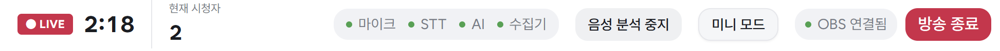

*그림 2. 상단 바 — 좌측부터 `● LIVE` 타이머, `현재 시청자`, 상태칩 4종, `음성 분석 중지`, `미니 모드`, `● OBS 연결됨`, `방송 종료`*

| 칩 | 회색일 때 조치 |
| --- | --- |
| 마이크 | 브라우저 주소창 좌측 자물쇠 → 마이크 권한 `허용` 후 새로고침 |
| STT | 상단 `음성 분석 중지` → 다시 `음성 분석 시작` 토글 |
| AI | 우측 하단 `AI 서버 연결됨` 문구 확인, 미연결 시 새로고침 |
| 수집기 | 치지직 방송이 실제로 **송출 중**인지 확인 (대기 상태면 채팅 수집 불가) |

### 1-3. 팀원 역할 분담

| 역할 | 담당 | 임무 |
| --- | --- | --- |
| 스트리머 | 발표자 | 멘트 진행 + 콘솔 조작 |
| 채터 A | 팀원 1 | ① 반복 질문 유발 ("오늘 뭐해요?" 계열 반복 입력) |
| 채터 B | 팀원 2 | ③ 월드컵 구간 채팅 볼륨 확보 (여론/열혈 시청자 데이터용) |
| 채터 C | 팀원 3 | ③ 채팅 참여 + ④ 위험 발언 트리거 담당 |

### 1-4. 데이터 사전 적재 (중요)

1부가 3분 30초로 짧아, **시연 중에 데이터가 쌓이기를 기다릴 시간이 없습니다.** 시작 전에 미리 채워 둡니다.

- ① **반복 질문**과 ⑥ **열혈 시청자 TOP3**는 누적 데이터가 필요합니다.
- 시연 시작 **5분 전부터** 채터 A/B/C가 채팅을 입력해 두어, 시연 시작 시점에 이미
  `반복 질문 Top 5`에 항목이 1건 이상, `열성 시청자` 목록에 3명 이상이 잡혀 있도록 합니다.
- 채터 A는 동일 취지 질문을 **3회 이상** 서로 다른 표현으로 입력합니다.
  예) `오늘 뭐함?` / `오늘 컨텐츠 뭐에요?` / `오늘 뭐하고 노나요`

### 1-5. 화면 배치

| 창 | 배치 | 비고 |
| --- | --- | --- |
| 방송 콘솔 (메인 브라우저) | 전체 화면, 발표 화면에 공유 | 시연 주 화면 |
| 미니 모드 오버레이 | 우측 하단 | ④ 위험 발언 알림을 띄울 창 |
| 치지직 채팅창 | 보조 모니터 | 채터 팀원용, 발표 화면에는 미공유 |

---

# 1부. 방송 중 기능 (3분 30초)

**사용 화면: `방송 콘솔`**

### 방송 콘솔 화면 구조 (3분할)

시연 중 계속 참조하므로 시작 전에 발표에서 **10초 이내로** 짚고 넘어갑니다.

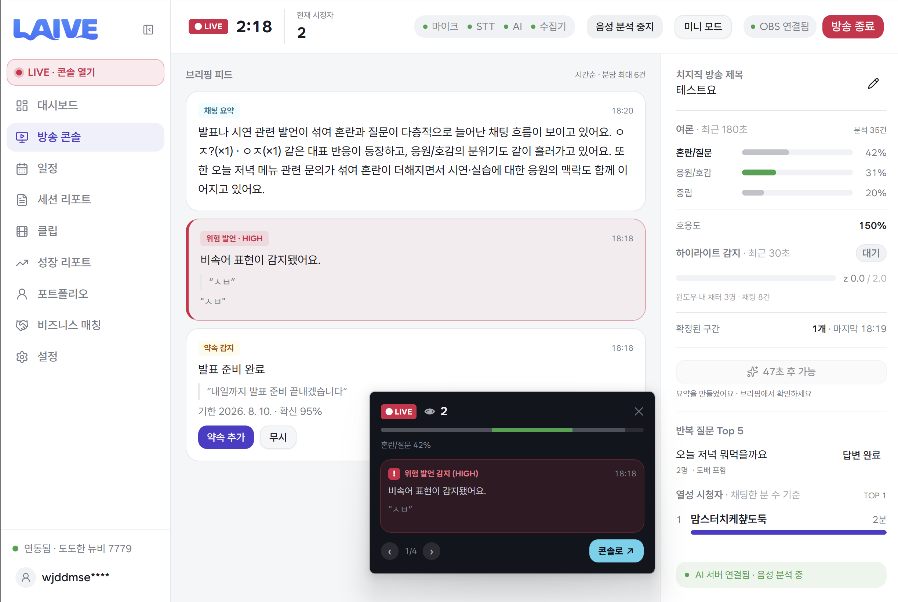

*그림 1. 방송 콘솔 전체 — 좌측 사이드바 / 중앙 브리핑 피드 / 우측 실시간 지표 패널 + 우측 하단 미니 모드 오버레이*

| 좌: 사이드바 | 중앙: 브리핑 피드 | 우: 실시간 지표 패널 |
| --- | --- | --- |
| `LIVE · 콘솔 열기` | `채팅 요약` 카드 (파란 배지) | `치지직 방송 제목` + 연필(✎) |
| `대시보드` | `위험 발언 · HIGH` 카드 (붉은 배경) | `여론` — 혼란/질문 · 응원/호감 · 중립 |
| **`방송 콘솔`** ◀ 현재 위치 | `약속 감지` 카드 (노란 배지) | `호응도` |
| `일정` | └ `약속 추가` / `무시` 버튼 | `하이라이트 감지` (z-score 게이지) |
| `세션 리포트` | ※ 정렬: 시간순 | `확정된 구간` |
| `클립` | ※ 표시 한도: 분당 최대 6건 | `✧ 요약 생성` (쿨다운 있음) |
| `성장 리포트` | | `반복 질문 Top 5` |
| `포트폴리오` | | `열성 시청자 TOP` |
| `비즈니스 매칭` | | `● AI 서버 연결됨 · 음성 분석 중` |
| `설정` | | |

---

## ① 오프닝 + 반복 질문 확인 — 40초 (00:00 ~ 00:40)

**화면: 방송 콘솔 → 우측 지표 패널 `반복 질문 Top 5`**

### 멘트

> "안녕하세요 스트리머 ○○입니다."

### 실행 순서

| # | 필수 | 클릭 위치 / 조작 | 화면 반응 |
| --- | --- | --- | --- |
| 1 | ★ | 좌측 사이드바 **`방송 콘솔`** 클릭 | 콘솔 3분할 화면 진입, 상단 `● LIVE` 타이머 카운트 시작 |
| 2 | ○ | 상단 상태칩 4종(마이크·STT·AI·수집기)을 **마우스로 짚으며** 설명 (클릭 X) | 4개 모두 초록 점으로 표시됨을 확인 |
| 3 | ★ | 오프닝 멘트 발화 | 하단 `음성 분석 중` 상태에서 STT가 발화를 수집 |
| 4 | ★ | 우측 지표 패널을 **아래로 스크롤** → **`반복 질문 Top 5`** 섹션으로 이동 | 누적된 질문 그룹 노출 |
| 5 | ★ | 질문 항목(예: **`오늘 저녁 뭐먹을까요`**) **클릭** | 카드가 확장되며 원본 채팅 목록 · 유입 인원 수(`2명 · 도배 포함`) 표시 |
| 6 | ○ | 항목 우측 **`답변 완료`** 배지 확인 (미답변 시 클릭하여 완료 처리) | 상태가 `답변 완료`로 전환, 해당 질문은 상위 노출에서 내려감 |

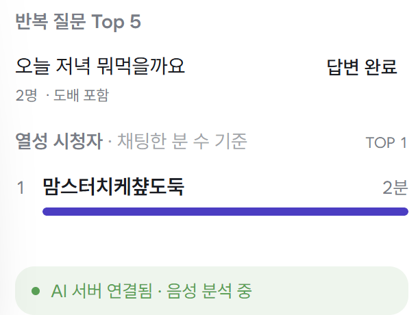

*그림 3. 우측 패널 하단 — `반복 질문 Top 5`(상단)와 `열성 시청자`(하단). ①과 ⑥에서 같은 영역을 사용합니다.*

### 멘트 (시연 중)

> "질문 하나 쌓여 있네요. 오늘 콘텐츠 뭐냐고 물어보시네요."

### 시연 포인트

- **같은 취지의 질문이 N회 이상 들어오면 자동으로 하나로 묶인다.**
  → 표현이 달라도(`오늘 뭐함?` / `오늘 컨텐츠 뭐에요?`) **의미 기준 클러스터링**으로 한 항목에 병합됨을 강조.
- 항목 아래 `2명 · 도배 포함` 표기 → **몇 명이 실제로 궁금해했는지**를 구분(도배 필터링)한다는 점을 짚습니다.
- 스트리머가 채팅창을 위로 거슬러 올라가지 않아도 **놓친 질문이 없다**는 것이 핵심 가치입니다.

---

## ② 콘텐츠 공지 + 약속 추가 — 45초 (00:40 ~ 01:25)

**화면: 방송 콘솔 → 중앙 브리핑 피드 `약속 감지` 카드**

### 멘트

> "오늘은 최강 동물 4강 이상형 월드컵입니다.
> 채팅 적극적으로 주신 **3분**께 **내일 안으로** 베라 기프티콘 드릴게요."

> ⚠️ **발화 시 주의**: `3분`, `내일` 두 단어를 또박또박 발음해야 대상 인원 수와 기한이 정확히 추출됩니다.

### 실행 순서

| # | 필수 | 클릭 위치 / 조작 | 화면 반응 |
| --- | --- | --- | --- |
| 1 | ★ | 위 멘트 발화 후 **2~5초 대기** | 중앙 브리핑 피드 최상단에 노란 배지 **`약속 감지`** 카드가 새로 생성 |
| 2 | ★ | 생성된 카드를 **손으로 가리키며** 내용 낭독 | 카드 구성: 제목(요약된 약속) / 인용된 원문 발화(`" … "`) / `기한 2026. 8. 10.` / `확신 95%` |
| 3 | ★ | 카드 하단 좌측 **`약속 추가`** (보라색 버튼) **클릭** | 버튼 영역이 등록 완료 상태로 전환, 토스트 노출, 카드가 "등록됨" 상태로 고정 |
| 4 | ○ | 좌측 사이드바 **`일정`** 클릭 | 일정 화면 진입 |
| 5 | ○ | 목록 최상단에 방금 등록된 약속 항목 확인 | `대상: 적극 참여 3인` / `기한: 내일(2026-08-10)` 로 등록되어 있음 |
| 6 | ○ | 좌측 사이드바 **`방송 콘솔`** 클릭하여 복귀 | LIVE 타이머는 끊기지 않고 계속 진행 중 (화면 이동해도 수집 유지) |

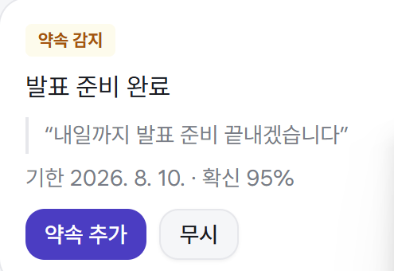

*그림 4. 중앙 브리핑 피드의 `약속 감지` 카드 — 원문 발화 인용, `기한 2026. 8. 10.`, `확신 95%`, 하단 `약속 추가` / `무시` 버튼*

> 💡 **시간 관리**: 4~6번(일정 화면 왕복)은 약 15초가 걸립니다. 앞 단계가 밀렸다면 생략하고,
> "등록된 약속은 `일정` 메뉴에서 관리됩니다"라고 **말로만** 처리한 뒤 ③으로 넘어갑니다.

### 시연 포인트

- **구두 약속을 자동으로 잡아내서 할 일로 등록**한다.
  → 스트리머가 방송 중 즉흥적으로 뱉은 말은 대부분 휘발되지만, LAIVE는 이를 **기한·대상이 붙은 태스크**로 변환합니다.
- `확신 95%` 수치를 짚으며, **확신도가 낮으면 `무시` 버튼으로 흘려보낼 수 있다**(오탐 제어)는 점을 함께 설명합니다.
- 이 약속은 **⑥ 열혈 시청자 TOP3와 다시 연결**되므로, 여기서 "이따 이 약속 다시 나옵니다"라고 예고합니다.

---

## ③ 본 콘텐츠 진행 — 최강 동물 4강 월드컵 — 40초 (01:25 ~ 02:05)

**화면: 방송 콘솔 (조작 최소화, 실제 콘텐츠 진행 구간)**

> 이 구간은 **데이터를 쌓는 시간**입니다. ⑤ 여론 요약과 ⑥ 열혈 시청자에 쓸 채팅이 이때 누적됩니다.
> 40초밖에 없으므로 **4강 2경기 + 결승을 각 10초 내외로 압축**해 진행합니다.

### 진행 순서

| # | 필수 | 조작 / 진행 | 화면 반응 |
| --- | --- | --- | --- |
| 1 | ★ | **구간 진입 직후 우측 패널 `✧ 요약 생성` 버튼을 1회 클릭** (⑤ 쿨다운 미리 소진) | 쿨다운 타이머 시작 — ⑤ 시점(02:45)에는 다시 활성화되어 있음 |
| 2 | ★ | 4강 대진 발표 (예: 사자 vs 하마 / 곰 vs 코끼리) | — |
| 3 | ★ | **채팅 참여 유도 멘트를 반복**: "1번이면 `1`, 2번이면 `2` 쳐주세요!" | 우측 `여론` 게이지 바가 실시간으로 변동 |
| 4 | ★ | 채터 A/B/C가 집중 채팅 입력 | 상단 `현재 시청자` 수, 우측 `호응도` 수치 상승 |
| 5 | ○ | 우측 패널 **`하이라이트 감지`** 영역을 짚기 | `z 0.0 / 2.0` 게이지가 채팅 급증에 따라 상승, 임계 초과 시 `대기` → 감지 상태로 전환 |
| 6 | ★ | 결승 진행, 최종 우승 동물 발표 | `확정된 구간` 카운트 증가 (`1개 · 마지막 18:19`) |

> ⚠️ **1번 단계는 반드시 실행합니다.** `✧ 요약 생성`은 약 **47초 쿨다운**이 있어, ⑤에서 처음 누르면
> 버튼이 `✧ 47초 후 가능`으로 비활성 상태입니다. ③ 진입 시 한 번 눌러 두면 ⑤에서 즉시 사용할 수 있습니다.

### 시연 포인트

- **하이라이트 감지**: 채팅량의 **z-score(표준편차 기반 급증도)** 로 "터진 순간"을 자동 판별합니다.
  → 이 구간에서 확정된 구간이 **2부 ② 자동 클립의 원본**이 됩니다.
- 브리핑 피드 우측 상단의 `시간순 · 분당 최대 6건` 표기를 짚으며, **알림 폭주를 막는 레이트 리밋**이 설계되어 있음을 설명합니다.
- 스트리머는 이 구간에서 **콘솔을 거의 보지 않습니다.** → "방송에 집중하는 동안 뒤에서 알아서 쌓인다"가 핵심 메시지입니다.

---

## ④ 위험 발언 감지 — 40초 (02:05 ~ 02:45)

**화면: 미니 모드 오버레이 → 방송 콘솔 중앙 브리핑 피드 `위험 발언 · HIGH` 카드**

> 미니 모드 창은 **사전 준비 1-1의 6번**에서 이미 띄워 두었습니다. 이 단계에서 새로 열지 않습니다.

### 실행 순서

| # | 필수 | 조작 / 진행 | 화면 반응 |
| --- | --- | --- | --- |
| 1 | ★ | 채터 C(팀원)가 스트리머 모욕성 발언 → **"이새기 쳐낼게요"** | STT가 발화를 수집, 위험도 분류 수행 |
| 2 | ★ | **2~4초 대기** | 미니 모드 오버레이에 **붉은 테두리 알림 카드** 팝업 — `! 위험 발언 감지 (HIGH)` / `비속어 표현이 감지됐어요.` / 원문 인용 / 시각 `18:18` |
| 3 | ○ | 오버레이 하단 **`1/4`** 표시와 **`‹` `›` 화살표** 짚기 | 다중 알림이 페이지 단위로 쌓임 — 놓친 알림도 되돌려 볼 수 있음 |
| 4 | ★ | 오버레이 우측 하단 **`콘솔로 ↗`** 버튼 **클릭** | 메인 브라우저 방송 콘솔로 포커스 이동 + 해당 알림 위치로 자동 스크롤 |
| 5 | ★ | 중앙 브리핑 피드의 **`위험 발언 · HIGH`** 카드(붉은 배경) 확인 | 배지 `위험 발언 · HIGH`, 우측 시각 `18:18`, 감지 사유, **원문 인용** 표시 |
| 6 | ○ | 카드를 클릭하여 상세 펼치기 | **발언 시점(타임스탬프)** 과 전후 맥락이 캡처되어 저장됨 |
| 7 | ○ | 좌측 사이드바 **`클립`** 클릭 → 클립 후보 등록 확인 → `방송 콘솔` 복귀 | 해당 구간이 **클립 후보로 자동 등록**되어 목록에 존재함 |

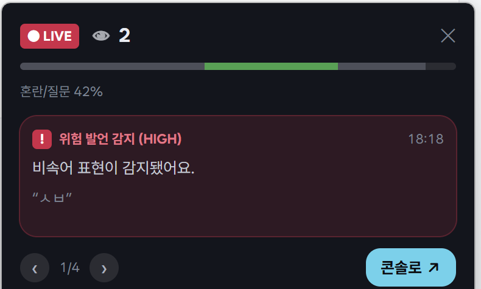

*그림 6. 미니 모드 오버레이 — 붉은 테두리 알림 카드, 하단 `1/4` 페이지 표시와 `‹` `›`, 우측 하단 `콘솔로 ↗` 버튼*

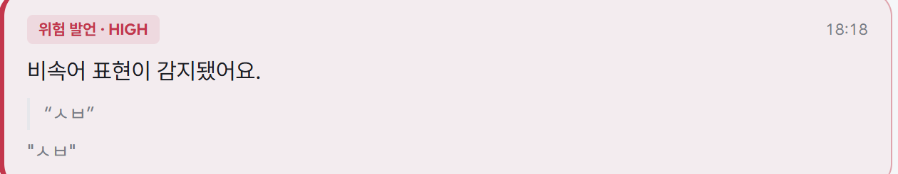

*그림 7. 중앙 브리핑 피드의 `위험 발언 · HIGH` 카드 — 감지 사유와 원문 인용, 우측에 발생 시각 `18:18`*

> 💡 **시간 관리**: 7번(클립 화면 왕복)은 **2부 ②에서 어차피 클립을 재생**하므로 생략을 권장합니다.
> "이 구간은 자동으로 클립 후보에 올라갑니다. 2부에서 바로 보여드리겠습니다"로 연결하면 자연스럽습니다.

### 시연 포인트

- **실시간 경고 + 사후 증거 확보를 동시에** 수행합니다.
  - *실시간*: 미니 모드 오버레이가 방송 화면 위에 즉시 경고 → 스트리머가 **그 자리에서 대응** 가능.
  - *사후*: 발언 시점·원문이 캡처되고 **클립 후보로 자동 등록** → 나중에 증거 자료로 바로 사용.
- 위험도가 `HIGH` 등급으로 라벨링되어, **등급별로 알림 강도를 달리한다**는 점을 설명합니다.
- 원문을 그대로 인용해 저장하므로, "그런 말 한 적 없다"는 분쟁 상황에서 **타임스탬프 + 원문**이 그대로 남습니다.

---

## ⑤ 여론 요약 — 25초 (02:45 ~ 03:10)

**화면: 방송 콘솔 → 우측 지표 패널 `여론` + `✧ 요약 생성` 버튼**

### 멘트

> "월드컵 끝났으니 여론 요약 한번 보고 갈게요."

### 실행 순서

| # | 필수 | 클릭 위치 / 조작 | 화면 반응 |
| --- | --- | --- | --- |
| 1 | ★ | 우측 패널 **`✧ 요약 생성`** 버튼 **먼저 클릭** (생성 시간 확보) | ③에서 쿨다운을 소진해 두었으므로 즉시 활성 상태 |
| 2 | ★ | 생성되는 동안 **`여론 · 최근 180초`** 게이지 3종을 읽기 | `혼란/질문 42%` · `응원/호감 31%` · `중립 20%` — 우측 `분석 35건` 표기 |
| 3 | ★ | 바로 아래 **`호응도`** 수치 확인 | `150%` — 평시 대비 반응 온도 (100% 초과 시 평소보다 뜨거움) |
| 4 | ★ | 시선을 **중앙 브리핑 피드 최상단**으로 이동 | 파란 배지 **`채팅 요약`** 카드 신규 생성 (`요약을 만들었어요 · 브리핑에서 확인하세요`) |
| 5 | ★ | 요약 카드 본문을 **한 문장만** 낭독 | 예: "혼란과 질문이 다층적으로 늘어난 채팅 흐름이 보이고 있어요. `ㅇㅈ?(×1)` 같은 대표 반응이 등장하고…" |
| 6 | ○ | 카드 내 **대표 반응 키워드**(`ㅇㅈ?(×1)` 등) 짚기 | 실제 채팅 원문 기반 키워드가 등장 횟수와 함께 인용됨 |

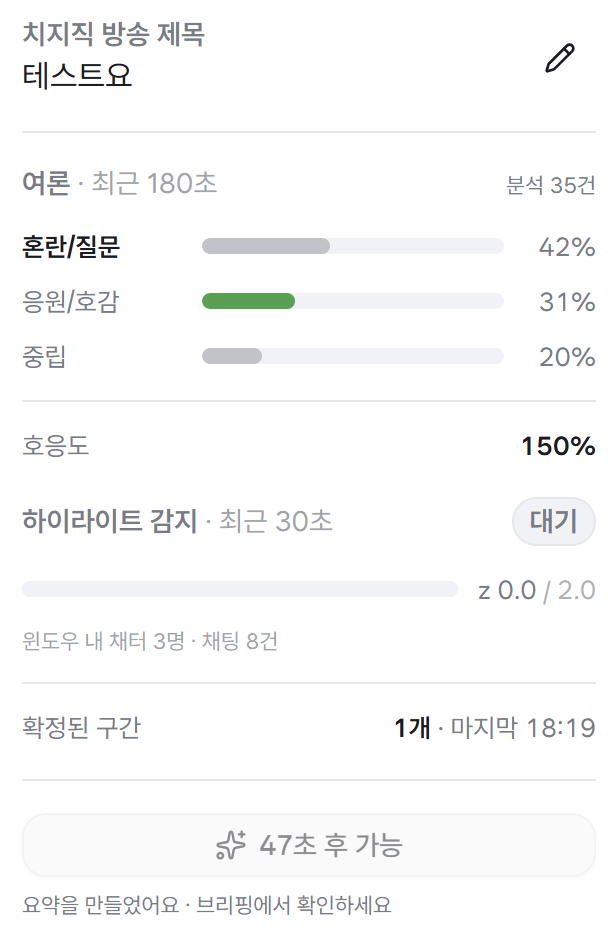

*그림 5. 우측 지표 패널 상단 — `여론`(혼란/질문 42%, 응원/호감 31%, 중립 20%), `호응도 150%`, `하이라이트 감지` z-score 게이지, `확정된 구간`, 하단 `✧ 요약 생성` 버튼(쿨다운 시 `47초 후 가능`)*

> 💡 **순서 주의**: 25초뿐이므로 **요약 생성 버튼을 먼저 누르고**, 생성되는 동안 게이지를 해설합니다.
> 게이지부터 읽고 나중에 누르면 생성 대기 시간이 그대로 공백이 됩니다.

### 시연 포인트

- 여론을 **세 가지 층위**로 나눠 보여줍니다.
  1. **선호 결과** — 어떤 쪽이 우세한지 (게이지 비율)
  2. **반응 온도** — 얼마나 뜨거운지 (`호응도 150%`)
  3. **주요 반응 키워드** — 어떤 말로 반응하는지 (대표 반응 인용)
- `최근 180초` 슬라이딩 윈도우 기준이므로, **"지금 이 순간"의 여론**이라는 점을 강조합니다.
- `✧ 47초 후 가능` 쿨다운은 **LLM 호출 비용·품질 관리**를 위한 의도된 설계임을 함께 언급합니다(무한 호출 방지).

---

## ⑥ 열혈 시청자 TOP3 + 방송 종료 — 20초 (03:10 ~ 03:30)

**화면: 방송 콘솔 → 우측 지표 패널 `열성 시청자` → 상단 `방송 종료`**

### 실행 순서

| # | 필수 | 클릭 위치 / 조작 | 화면 반응 |
| --- | --- | --- | --- |
| 1 | ★ | 우측 패널 **최하단**으로 스크롤 → **`열성 시청자 · 채팅한 분 수 기준`** 섹션 | 순위 목록 노출, 우측에 `TOP 1` / `TOP 3` 필터 표시 |
| 2 | ★ | 1~3위를 빠르게 읽기 (예: **`맘스터치케챂도둑`** `2분`) | 닉네임 + 참여 시간 + 참여도 바 그래프 |
| 3 | ★ | **② 에서 등록한 약속**과 말로 연결 | `적극 참여 3인 / 기한 내일` 약속과 TOP3 명단이 그대로 매칭 |
| 4 | ★ | 멘트 발화 | — |
| 5 | ★ | 상단 우측 **`방송 종료`** (빨간 버튼) 클릭 → 모달에서 **`종료`** 클릭 | LIVE 타이머 정지, 세션 마감 처리 시작, 세션 리포트 생성 안내 노출 |

> 화면은 **그림 3**(반복 질문 / 열성 시청자)의 하단 영역을 사용합니다.

### 멘트

> "이 세 분께 기프티콘 드릴게요. 오늘 방송 여기서 마치겠습니다. 감사합니다!"

### 시연 포인트

- **② 약속 등록 → ⑥ 대상자 확정**이 하나의 흐름으로 닫힙니다.
  → "누구한테 준다고 했더라?"를 스트리머가 기억할 필요가 없다는 것이 이 기능의 결론입니다.
- 랭킹 기준이 **단순 채팅 수가 아니라 참여 시간 기반**이므로, 도배 유저가 상위를 차지하지 않습니다.
- 방송 종료 버튼 클릭이 **1부의 종료이자 2부의 시작점**입니다. 여기서 자연스럽게 2부로 넘어갑니다.

---

# 2부. 방송 후 기능 (1분 30초)

> 브릿지 멘트: "방송은 끝났지만, LAIVE의 진짜 일은 지금부터입니다."

> ⏱️ 2부는 **90초 안에 4개 화면**을 지나갑니다. 각 화면에서 **한 가지 메시지만** 전달하고 즉시 다음으로 넘어갑니다.
> 스크롤·클릭을 최소화하기 위해, 발표 직전에 각 화면을 미리 한 번씩 열어 **브라우저 탭에 로딩해 두는 것**을 권장합니다.

---

## ① 세션 리포트로 방송 복기 — 30초 (00:00 ~ 00:30)

**화면: 사이드바 `세션 리포트`**

### 실행 순서

| # | 필수 | 클릭 위치 / 조작 | 화면 반응 |
| --- | --- | --- | --- |
| 1 | ★ | 좌측 사이드바 **`세션 리포트`** 클릭 → 목록 **최상단(가장 최근 방송)** 항목 클릭 | 방금 종료한 세션의 상세 리포트 열림 |
| 2 | ○ | 상단 **요약 지표** 확인 | 평균 시청자 / 최고 시청자 / 총 채팅 수 / 방송 길이 |
| 3 | ★ | **`AI 요약`** 카드 **한 문장만** 낭독 | 예: "평균 시청자 1명, 최고 3명으로 참여가 저조했고, 감정 분석 결과 분노가 100%를 차지했습니다." |
| 4 | ★ | 아래로 스크롤 → **`개선 제안`** 카드의 **제목 3개만** 읽기 | ① 방송 시간과 설명 간결화 ② 부정적 감정 완화 및 소통 강화 ③ 시청자 참여 유도 및 채팅 활성화 |
| 5 | ★ | 계속 스크롤 → **타임라인** 영역으로 이동 | 시간축을 따라 1부 이벤트가 마커로 배치됨 |
| 6 | ★ | 타임라인 마커 중 **`위험 발언` 1개만** 클릭 | 1부 ④ 시점의 상세(등급·시각·원문·연결 클립)가 펼쳐짐 |
| 7 | ○ | 나머지 마커(`반복 질문` / `약속` / `여론`)도 순서대로 클릭 | 각 시점의 상세가 펼쳐짐 |

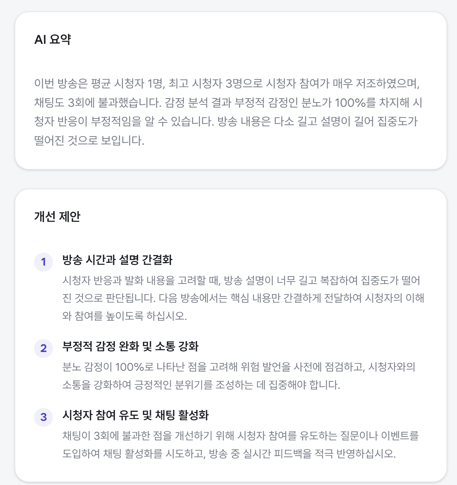

*그림 8. 세션 리포트 — 상단 `AI 요약`(지표 기반 진단), 하단 `개선 제안` 3건(번호별 근거 문장 포함)*

### 타임라인 복기 대응표 (1부와 1:1)

| 클릭할 마커 | 1부 대응 | 확인할 내용 | 필수 |
| --- | --- | --- | --- |
| **위험 발언** | 1부 ④ | `HIGH` 등급 + 발언 시각 + 원문 인용 + 연결된 클립 | ★ |
| **약속** | 1부 ② | 원문 발화 인용 + 기한(2026-08-10) + 대상(3인) + 확신도 | ○ |
| **반복 질문** | 1부 ① | 묶인 질문 그룹 + 원본 채팅 + 답변 완료 여부 | ○ |
| **여론** | 1부 ⑤ | 해당 시점의 여론 비율 스냅샷 + 호응도 + 대표 반응 | ○ |

### 시연 포인트

- **1부에서 실시간으로 지나갔던 이벤트가 하나도 유실되지 않고 타임라인에 남아 있다**는 것을 보여줍니다.
- `AI 요약`은 "잘했다/못했다"가 아니라 **수치를 근거로 한 진단**이며, `개선 제안`은 그 진단에서 도출된 **행동 지침**임을 구분해 설명합니다.
- 이 개선 제안이 **③ 성장 리포트의 목표 추천으로 이어진다**고 예고합니다.

---

## ② 클립 확인 — 20초 (00:30 ~ 00:50)

**화면: 사이드바 `클립`**

### 실행 순서

| # | 필수 | 클릭 위치 / 조작 | 화면 반응 |
| --- | --- | --- | --- |
| 1 | ★ | 좌측 사이드바 **`클립`** 클릭 | 자동 생성된 클립 목록(썸네일 그리드) 진입 |
| 2 | ○ | 상단 필터에서 **최근 방송 세션** 선택 | 방금 종료한 방송의 클립만 필터링 |
| 3 | ★ | **위험 발언 구간 클립** 썸네일 클릭 → **5초만 재생** | 플레이어 열림 → 1부 ④ 발언 시점부터 재생 |
| 4 | ★ | 목록으로 돌아가 **월드컵 하이라이트 클립** 썸네일 확인 | 1부 ③ `확정된 구간`(채팅 급증 z-score 초과) 기준으로 잘린 클립 |
| 5 | ○ | 하이라이트 클립도 재생 | — |
| 6 | ○ | 클립 카드의 **클립 번호(예: `#19`)** 확인 | 이후 ④ 포트폴리오에서 이 번호로 다시 참조됨 |

### 시연 포인트

- 클립은 **수동 편집 없이 자동 생성**됩니다. 두 가지 서로 다른 트리거를 대비시켜 설명합니다.
  - **위험 발언 클립** → *위험도 분류* 트리거 (증거 확보 목적)
  - **하이라이트 클립** → *채팅 급증(z-score)* 트리거 (콘텐츠 재활용 목적)
- 같은 자동 클립 기능이 **리스크 관리**와 **콘텐츠 자산화** 양쪽에 쓰인다는 점이 이 화면의 메시지입니다.
- 여기서 확인한 클립이 **④ 포트폴리오 대표 하이라이트로 연결**됨을 예고합니다.

---

## ③ 성장 리포트 → 목표 설정 — 20초 (00:50 ~ 01:10)

**화면: 사이드바 `성장 리포트` → `목표 로드맵`**

### 실행 순서

| # | 필수 | 클릭 위치 / 조작 | 화면 반응 |
| --- | --- | --- | --- |
| 1 | ★ | 좌측 사이드바 **`성장 리포트`** 클릭 → 아래로 스크롤 → **`목표 로드맵`** 섹션 | 안내 문구: `새 방송 데이터가 쌓였어요. 다시 추천하면 최신 지표로 목표를 만들어 드려요.` |
| 2 | ○ | 상단 **지표 추이 그래프** 확인 | 평균 시청자 / 채팅 수 / 방송 횟수의 기간별 변화 |
| 3 | ★ | 섹션 우측 상단 **`⟳ 다시 추천`** 클릭 | 방금 종료한 방송 데이터를 반영해 **목표 카드 3장 재생성** |
| 4 | ★ | 카드 3장의 **제목만** 빠르게 읽기 | `평균 시청자 3명` / `주당 방송 횟수 7회` / `총 채팅 2,000개` |
| 5 | ★ | 첫 카드 본문의 **근거 문장** 낭독 | "현재 평균 시청자 수는 1.75명으로 … 3명으로 증가시키는 것은 현실적이며 도전 가능한 목표입니다." |
| 6 | ★ | 첫 카드의 **`목표로 채택`** (보라색 버튼) 클릭 | 카드가 채택 상태로 전환, 상단 진행 트래커에 목표가 등록됨 |
| 7 | ○ | 카드 하단 **`💡 실행 액션 3개 ⌄`** 클릭 | 아코디언이 펼쳐지며 구체적 실행 방안 3가지 노출 |
| 8 | ○ | 두 번째 카드의 **`무시`** 클릭 | 해당 추천이 목록에서 제거됨 — 취사 선택 가능함을 시연 |

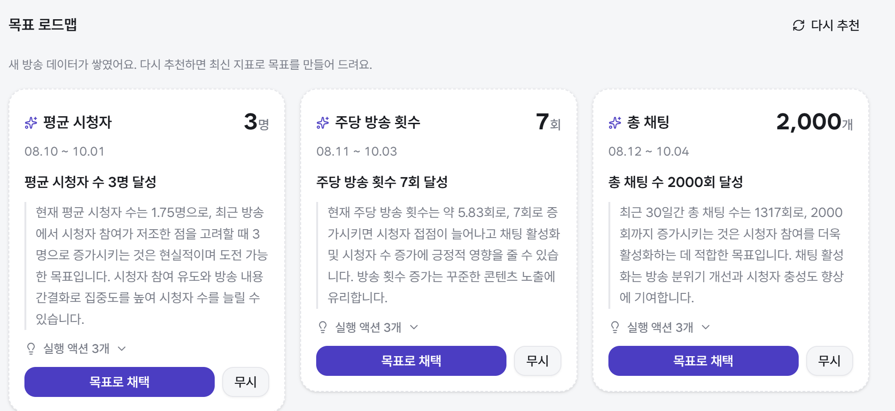

*그림 9. `목표 로드맵` — 목표 카드 3장. 각 카드에 목표 수치, 기간, 현재 지표를 인용한 근거 문장, `실행 액션 3개`, `목표로 채택` / `무시` 버튼*

### 시연 포인트

- 목표가 **템플릿이 아니라 내 데이터 기반**입니다. → 현재 1.75명 → 3명처럼 **현재 수치를 명시한 근거**가 카드마다 붙습니다.
- `무시` 버튼으로 **추천을 거를 수 있고**, `⟳ 다시 추천`으로 최신 지표 기준 재생성이 가능 → **스트리머가 주도권을 갖는 구조**입니다.
- **2부 ①의 `개선 제안` → ③의 `목표 로드맵`** 이 이어지는 흐름임을 명시합니다.

---

## ④ 포트폴리오 매칭 수정 — 15초 (01:10 ~ 01:25)

**화면: 사이드바 `포트폴리오`**

### 실행 순서

| # | 필수 | 클릭 위치 / 조작 | 화면 반응 |
| --- | --- | --- | --- |
| 1 | ★ | 좌측 사이드바 **`포트폴리오`** 클릭 | 상단 안내: `광고주와 다른 스트리머에게 보여줄 공개 프로필을 관리하세요.` |
| 2 | ★ | **`방송 실적`** 옆 회색 문구 **`자동 집계되며 직접 수정할 수 없어요`** 짚기 | 실적 지표는 **위변조 불가** — 광고주 신뢰의 근거 |
| 3 | ○ | `방송 실적` 카드 6종 확인 | `평균 시청자 2` / `최고 동시 시청자 5` / `주당 방송 7회` / `총 방송 횟수 26` / `누적 채팅 1,352` / `주 방송 시간대 17:00-17:00` |
| 4 | ★ | 아래로 스크롤 → **`대표 하이라이트`** 카드로 이동 | 안내: `공개 포트폴리오 상단에 이 순서대로 보여집니다.` / `담은 클립 1` |
| 5 | ★ | 하단 **`방송을 선택하세요 ⌄`** 드롭다운 클릭 → **오늘 방송(월드컵 세션)** 선택 | 하단에 **클립 후보 목록** 노출 (2부 ②에서 본 클립들) |
| 6 | ★ | **월드컵 하이라이트 클립**을 선택해 담기 | `담은 클립` 카운트가 `1` → `2` 로 증가 |
| 7 | ★ | 담긴 클립 우측 **`↑`** 화살표 클릭 → 하단 **`저장`** 클릭 | 노출 순서 변경 후 저장 완료 토스트, 공개 포트폴리오에 즉시 반영 |
| 8 | ○ | 기존 클립(**`#19`**) 우측 **`✕`** 클릭 | 대표 하이라이트에서 제거 |
| 9 | ○ | 좌측 사이드바 **`비즈니스 매칭`** 클릭 | 수정된 포트폴리오 기준으로 **매칭 결과가 갱신**되어 표시됨 |

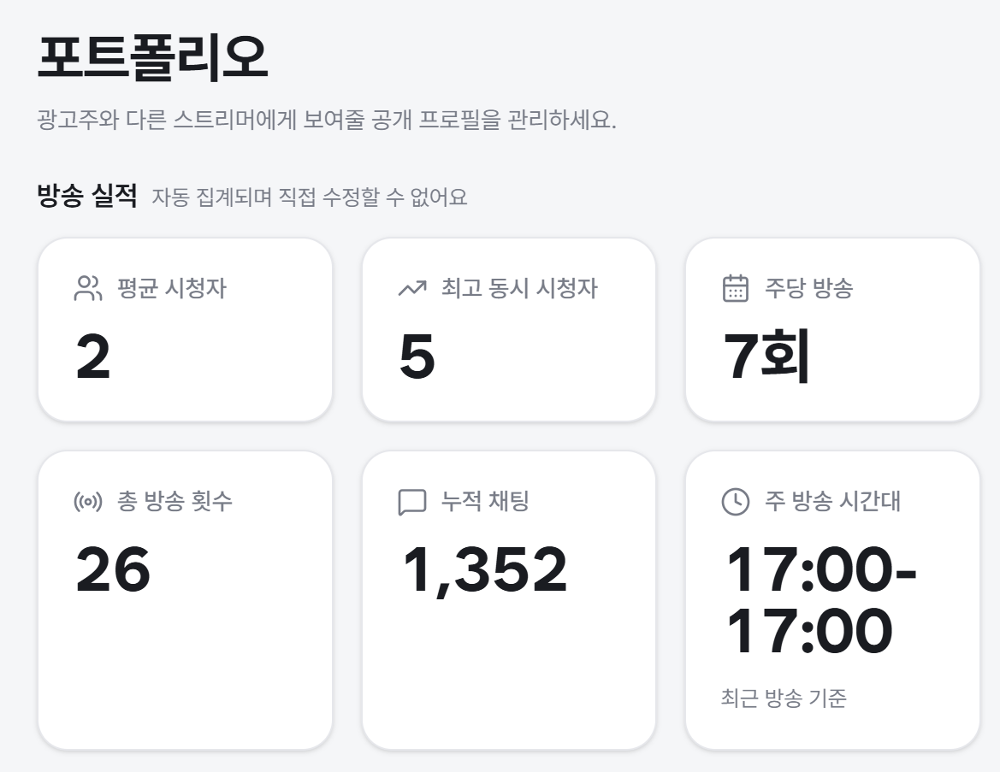

*그림 10. `방송 실적` — 6개 지표 카드. 제목 옆 `자동 집계되며 직접 수정할 수 없어요` 문구가 위변조 불가를 나타냅니다.*

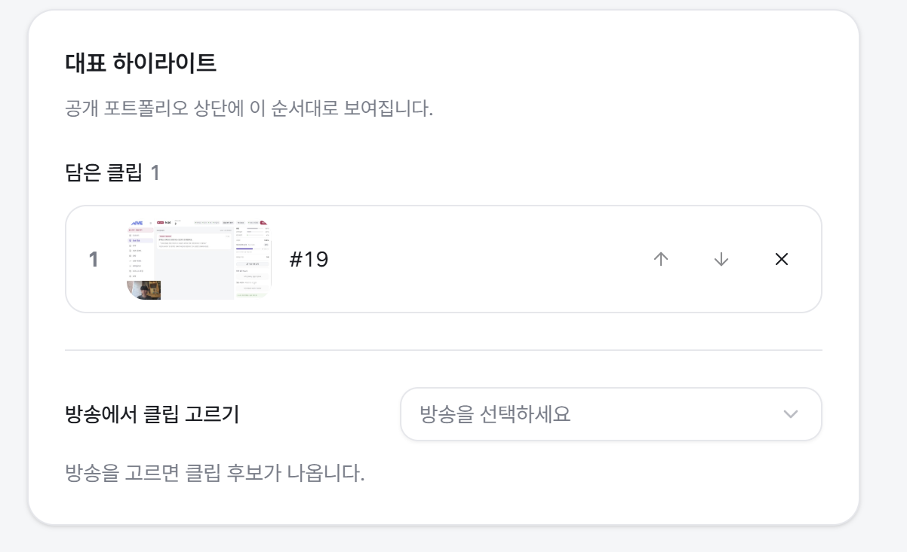

*그림 11. `대표 하이라이트` — 담은 클립 목록(`#19`)과 우측의 순서 변경(`↑` `↓`) · 제거(`✕`) 컨트롤, 하단 `방송에서 클립 고르기` 드롭다운*

### 시연 포인트

- 포트폴리오는 **자동 집계 영역**(방송 실적, 수정 불가)과 **큐레이션 영역**(대표 하이라이트, 수정 가능)으로 나뉩니다.
  → 숫자는 못 건드리게 해서 **신뢰성**을, 클립은 고를 수 있게 해서 **표현력**을 확보한 설계입니다.
- 1부에서 만든 클립이 **별도 편집 작업 없이** 그대로 광고주용 포트폴리오 자산이 됩니다.

---

## ⑤ 마무리 멘트 후 종료 — 5초 (01:25 ~ 01:30)

### 마무리 멘트

> "방송 중에는 놓친 질문과 약속, 위험한 순간을 **실시간으로 잡아주고**,
> 방송이 끝나면 그 기록이 **리포트 · 클립 · 성장 목표 · 포트폴리오**로 자동으로 이어집니다.
> 이상 LAIVE 시연을 마치겠습니다. 감사합니다."

### 종료 처리 (시연 시간 외)

| # | 조작 |
| --- | --- |
| 1 | 미니 모드 오버레이 창 우측 상단 **`✕`** 클릭하여 닫기 |
| 2 | OBS Studio → `방송 중단` |
| 3 | 좌측 사이드바 **`대시보드`** 클릭 (전체 요약 화면으로 마무리) |

---

# 부록

## A. 전체 시연 타임라인 요약 (5분)

| 부 | 단계 | 구간 | 화면 | 핵심 클릭 | 소요 |
| --- | --- | --- | --- | --- | --- |
| 1부 | ① 오프닝 + 반복 질문 | 00:00~00:40 | 방송 콘솔 (우측 패널) | `반복 질문 Top 5` 항목 클릭 | 40초 |
| 1부 | ② 콘텐츠 공지 + 약속 | 00:40~01:25 | 방송 콘솔 (중앙 피드) | **`약속 추가`** 버튼 | 45초 |
| 1부 | ③ 월드컵 진행 | 01:25~02:05 | 방송 콘솔 | **`✧ 요약 생성`** 선(先)클릭 (쿨다운 소진) | 40초 |
| 1부 | ④ 위험 발언 감지 | 02:05~02:45 | 미니 모드 → 방송 콘솔 | **`콘솔로 ↗`** 버튼 | 40초 |
| 1부 | ⑤ 여론 요약 | 02:45~03:10 | 방송 콘솔 (우측 패널) | **`✧ 요약 생성`** 버튼 | 25초 |
| 1부 | ⑥ 열혈 시청자 + 종료 | 03:10~03:30 | 방송 콘솔 (우측 패널) → 상단 | **`방송 종료`** 버튼 | 20초 |
| | **1부 소계** | | | | **3분 30초** |
| 2부 | ① 세션 리포트 복기 | 00:00~00:30 | 세션 리포트 | 타임라인 `위험 발언` 마커 클릭 | 30초 |
| 2부 | ② 클립 확인 | 00:30~00:50 | 클립 | 위험 발언 클립 썸네일 재생 | 20초 |
| 2부 | ③ 성장 리포트 → 목표 | 00:50~01:10 | 성장 리포트 | **`⟳ 다시 추천`** → **`목표로 채택`** | 20초 |
| 2부 | ④ 포트폴리오 수정 | 01:10~01:25 | 포트폴리오 | 클립 담기 → `↑` → **`저장`** | 15초 |
| 2부 | ⑤ 마무리 | 01:25~01:30 | — | — | 5초 |
| | **2부 소계** | | | | **1분 30초** |
| | **총계** | | | | **5분** |

## B. 1부 → 2부 데이터 연결 관계

시연 중 "이게 아까 그거예요"라고 짚어야 할 연결 고리입니다.

| 1부에서 발생 | 2부에서 확인 |
| --- | --- |
| ① 반복 질문 묶음 | 2부 ① 타임라인 `반복 질문` 마커 |
| ② 약속 감지 → `약속 추가` | 사이드바 `일정` 등록 / 2부 ① 타임라인 `약속` 마커 |
| ② 약속 대상 "3분" | 1부 ⑥ 열혈 시청자 TOP3 명단 |
| ③ 하이라이트 감지 `확정된 구간` | 2부 ② 월드컵 하이라이트 클립 → 2부 ④ 대표 하이라이트 |
| ④ 위험 발언 `HIGH` | 2부 ① 타임라인 `위험 발언` 마커 / 2부 ② 위험 발언 클립 |
| ⑤ 여론 요약 · 호응도 | 2부 ① `AI 요약` · `개선 제안` → 2부 ③ 목표 로드맵 |
| 방송 전체 지표 | 2부 ④ 포트폴리오 `방송 실적` (자동 집계) |

## C. 돌발 상황 대응 (Plan B)

5분 시연에서는 복구 시간이 없습니다. **재시도는 1회까지만** 하고, 실패하면 즉시 다음 단계로 넘어갑니다.

| 상황 | 원인 | 대응 |
| --- | --- | --- |
| ② 약속 카드가 안 뜸 | 발화 인식 실패 / 기한·대상 표현 누락 | **1회만** 재발화(기한·인원 수를 또박또박). 그래도 안 뜨면 그림 4 캡처로 설명하고 ③으로 진행 |
| ④ 위험 발언 알림 미발생 | 위험도 임계 미달 | 채터 C가 **더 명확한 비속어**로 1회 재시도. 실패 시 그림 6·7 캡처로 설명 |
| ⑤ `요약 생성` 비활성 | ③에서 쿨다운 선(先)소진을 놓침 | 요약 생성을 포기하고 **여론 게이지 3종 + 호응도만** 해설 (25초 안에 소화 가능) |
| 상태칩이 회색으로 변함 | 네트워크 / 권한 문제 | 시연 중에는 **복구를 시도하지 않습니다.** 해당 기능을 건너뛰고 진행 |
| 채팅이 안 쌓임 | 치지직 송출 상태 아님 | 사전 준비 단계에서 반드시 확인. 시연 중 발생 시 채터 팀원이 즉시 입력 재개 |
| 2부 리포트가 비어 있음 | 세션 마감 처리 지연 | 즉시 **이전 세션 리포트**로 전환해 동일 흐름 시연 (사전에 이전 세션을 탭에 열어 둘 것) |
| 전체 시간 초과 | — | 2부 ④를 **그림 10·11 설명으로만** 대체 (15초 → 5초) |

## D. 시연 시 강조할 한 줄 메시지

각 단계에서 **딱 한 문장**만 남긴다면 이것입니다.

| 단계 | 한 줄 |
| --- | --- |
| 1부 ① | "채팅창을 거슬러 올라가지 않아도, 놓친 질문은 알아서 묶여 있습니다." |
| 1부 ② | "말로 뱉은 약속이 기한과 대상이 붙은 할 일이 됩니다." |
| 1부 ③ | "방송에 집중하는 동안, 데이터는 뒤에서 쌓입니다." |
| 1부 ④ | "지금 경고하고, 나중을 위한 증거까지 남깁니다." |
| 1부 ⑤ | "무엇을 좋아하는지, 얼마나 뜨거운지, 어떤 말로 반응하는지." |
| 1부 ⑥ | "누구한테 준다고 했는지, 기억할 필요가 없습니다." |
| 2부 ① | "지나간 방송이 아니라, 다시 열어볼 수 있는 기록입니다." |
| 2부 ② | "편집 없이, 남길 장면과 지울 장면이 나뉘어 있습니다." |
| 2부 ③ | "다음에 뭘 해야 할지를 내 숫자로 알려줍니다." |
| 2부 ④ | "숫자는 못 고치고, 보여줄 장면은 내가 고릅니다." |

---

*문서 버전 2.0 · 작성일 2026-08-09*